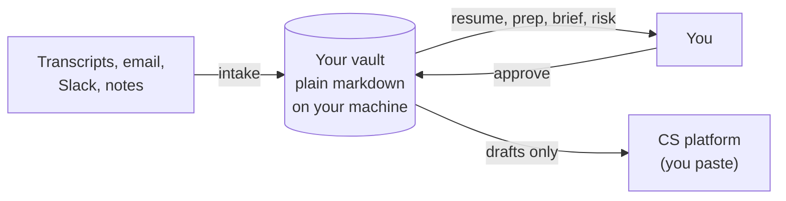

# intel-vault

**An AI-maintained notebook for your accounts.** Every meeting, email, and commitment lands in one folder of plain notes on your own computer. Your AI assistant keeps those notes current, preps you for calls, and reminds you what you owe people.

Built by a Customer Success Engineer, from months of running a real book of enterprise accounts with it.

> **Status: v0.1.** Ready for Customer Success Engineers. SE and people-manager versions are in progress. See the [roadmap](docs/ROADMAP.md).

---

## The problem it solves

If you run a book of accounts, you already know these:

- **Context is scattered.** The real story of an account is spread across meeting transcripts, email threads, Slack, support cases, and your memory.
- **Commitments leak.** "I'll send that over Friday" gets said on a call and lives nowhere.
- **Every AI chat starts from zero.** You re-explain the account every time, and the assistant forgets it when the window closes.
- **The CS platform lags reality.** Things happen in meetings weeks before they reach Gainsight (or whatever you use), and leadership reads the platform.
- **Review time means reconstruction.** You spend a weekend digging through email to remember what you accomplished.

## What it does for a CSE

| Moment | You say | You get |
|---|---|---|
| **Start of the day** | `resume` | Three lines: what's in flight, what's overdue (your own commitments first), what needs a decision today |
| **After a customer call** | `intake Acme` + the transcript | The raw transcript saved untouched, a meeting record written, and a "what changed" summary: new risks, new stakeholders, commitments made, anything that contradicts what you knew. It waits for your OK, then updates every affected file and your task list |
| **Before a call or QBR** | `prep Acme QBR` | A one-page brief: the one thing you must leave with, who's in the room and what they care about, what you owe them, landmines, questions to ask |
| **Before a risk review** | `risk Acme` | A strict scorecard against your risk signals, plus a "credible plan" test on every open risk, and the questions your manager will ask |
| **CS platform upkeep** | `gainsight Acme` | A timeline entry, sentiment change, or CTA drafted for you to paste. **It never touches the platform itself** |
| **Monday morning** | `brief` | Renewals inside 120 days, accounts gone quiet, what's in the vault but not yet in the platform |
| **End of the day** | `wrap` | A session log, proposed status and task updates, and a prompt to log anything worth a mention at review time |
| **Review season** | `review-prep FY26` | Your accomplishments with dates and numbers, sourced, plus a list of where the evidence is thin |

No command is required. Plain English works; the commands just load a specific checklist.

## See it before you set it up

[`examples/demo-vault/`](examples/demo-vault/) is a small working vault for a fictional account. Start with:

- [`AGENTS.md`](examples/demo-vault/AGENTS.md): the one-screen view of every account
- [`Open Actions.md`](examples/demo-vault/Open%20Actions.md): one task list, every item with a source and date
- [The meeting record](examples/demo-vault/Accounts/Bluefin%20Logistics/Vault%20Enterprise/Meetings/2026-10-20%20Bluefin%20Upgrade%20Sync.md) written from [this transcript](examples/demo-vault/Accounts/Bluefin%20Logistics/Sources/2026-10-20%20Upgrade%20Sync%20Transcript.md)
- [A call prep brief](examples/demo-vault/Accounts/Bluefin%20Logistics/_Prep/2026-10-27%20Bluefin%20Cadence%20Prep.md)
- [A session log](examples/demo-vault/_Sessions/2026-10-20-bluefin-upgrade-sync.md) with a drafted timeline entry

## How it works



- **Your notes are plain files.** Open them in any editor, or in Obsidian for links and graphs. Nothing is locked in a vendor.
- **The rules travel with the notes.** A `_system/` folder in the vault tells any AI how to behave. Change AI tools, or use two at once, and you lose nothing.
- **You stay in control.** The AI shows you what it wants to change and waits. It never sends, submits, or logs anything outside the vault without your yes.

## Use more than one AI on the same notes

Many people end up with two assistants: one that is good at batch work (process a week of transcripts, update every account) and one that is convenient for quick questions (a separate chat per account for summaries and context switching). The usual problem is that each one keeps its own memory, so they drift apart and you become the copy-and-paste layer between them.

**Here, neither assistant holds the memory. The vault does.**

- **Every tool reads the same files and follows the same rules,** so an update made in one shows up in the other on the next `resume`.
- **Per-account context without per-account chats.** `resume Acme` or `prep Acme` rebuilds an account's context in any tool, in any new chat, from the files. A chat window can close without losing anything.
- **Use each tool for what it is good at,** and switch tools without losing anything.

This has run day to day with two different AI tools writing the same vault. Two things make it work, and both are in the rules:

- **One assistant per account at a time.** Shared files are coordinated by convention, not by locks. Before writing, an assistant checks whether the files changed in the last hour and stops to ask if another tool has been working that account.
- **The tool has to be able to read the folder.** Desktop and editor-based assistants that open a local folder can read and write it. Office-suite assistants that only reach cloud storage may be limited to reading copies of the notes; check yours first (see [adapters/any-llm.md](adapters/any-llm.md)).

## Guardrails that come built in

Every one of these exists because an AI got it wrong without it:

- **No fabrication.** No invented ticket numbers, links, names, or dates. "I don't know" is an acceptable answer.
- **Sources are never edited.** The original transcript is always there to check against.
- **Every claim is tagged** Confirmed, Assumption, Historical, or Unknown, with its source.
- **Time discipline.** A past date is never written as upcoming. Stale accounts are called out as stale.
- **Names are checked against the strongest source.** Transcripts misspell names and confuse two people with the same first name; the rules catch both.
- **One task list.** Never a second one hiding in a meeting note.
- **Real counts, not "looks clean."** A checker script counts broken links and banned characters, because AI tools report clean when it isn't.

## Works with your AI tool

Claude (desktop app with folder access) is the most tested. Any assistant that can read a folder can follow the same rules. A chat-only tool can still use it: it gives you file contents to save instead of writing them. See [adapters/any-llm.md](adapters/any-llm.md).

---

## Quickstart (about 15 minutes)

**Needs:** Python 3 (built into macOS and most Linux; on Windows install from python.org) and an AI tool that can read your vault folder.

```bash
git clone https://github.com/benz0/intel-vault.git
cd intel-vault

# Customer Success Engineer, using Claude, with an em dash ban
python3 scripts/new-vault.py ~/intel-vault-work --packs cse \
  --owner "Jordan Lee" --initials JL --role "Customer Success Engineer" \
  --org "Example Co" --manager "Pat Smith" --tz America/New_York \
  --agents claude --no-em-dash
```

Then:

1. **Fill in** `_system/config.md` (especially `data_policy`) and `_system/local/rules/10-owner.md` (your writing style, signature, vocabulary).
2. **Connect your AI:**
   - **Claude:** add the skill in `_system/adapters/claude/intel-vault/` to Claude, and attach only the vault folder.
   - **Anything else:** see [adapters/any-llm.md](adapters/any-llm.md).
   - **A tool that only reads its own rules folder:** set `export_rules_dir` (and the skills and commands equivalents) in config, then run `python3 _system/scripts/export-agent-files.py`.
3. Say **`resume`**.

### Updating

```bash
cd intel-vault && git pull
python3 scripts/update-vault.py ~/intel-vault-work            # add --dry-run to preview
```

Updates replace core and pack files in `_system/`. They never touch `_system/config.md`, `_system/local/`, or your notes.

---

## Packs

| Pack | For | Status |
|---|---|---|
| `cse` | Customer Success Engineers, TAMs: accounts, product relationships, renewals, risk, a customer-success platform the vault feeds but never writes to | v0.1 |
| `se` | Sales/Solutions Engineers: opportunities, MEDDPICC, CRM updates drafted for you to paste | Planned |
| `people-manager` | Supervisors: direct reports, 1:1s, team metrics, accounts you assist on | Planned |
| `personal-life` | Home, family admin, finances, a personal task list kept separate from work | Planned |

A pack is a folder with `pack.md`, `rules/`, `workflows/`, and `templates/`. Copy `packs/cse` to start a new one.

---

## Customizing without forking

Put anything specific to you or your employer in `_system/local/`:

- `local/rules/10-owner.md`: your style, signature, vocabulary
- `local/rules/30-{employer}-process.md`: your organization's actual process (risk model, field values, approval chain)
- `local/workflows/{name}.md`: replaces a core or pack workflow of the same name, or adds a new command

Local always wins, and updates never overwrite it.

---

## Hygiene

```bash
python3 _system/scripts/check-vault.py            # whole vault
python3 _system/scripts/check-vault.py Accounts/Acme
```

Counts forbidden characters (minus any exact strings you exempt in `forbidden_chars_allow`, such as a signature), broken wikilinks, ambiguous bare links, and likely alias mismatches. AI tools report "clean" when it isn't; this gives you a number.

`_system/scripts/sheet-to-md.py` converts a spreadsheet into a disposable markdown cache (needs `openpyxl` for .xlsx).

---

## Privacy

- **Keep this repo free of real data.** It holds the spec only. Your vault is a separate folder.
- **A work vault on an employer laptop, run through an employer's AI account, may be visible to your employer.** Keep personal matters out of it.
- **Check your employer's AI policy** before putting customer or employee data in any AI tool, and record the short version in `data_policy`.

## Credits

Account file templates adapted from Kwadwo Eck's account management assistant prompt, the starting point for this whole project. The session-memory loop is adapted from the Claude Code + Obsidian pattern shared on r/ClaudeAI.
